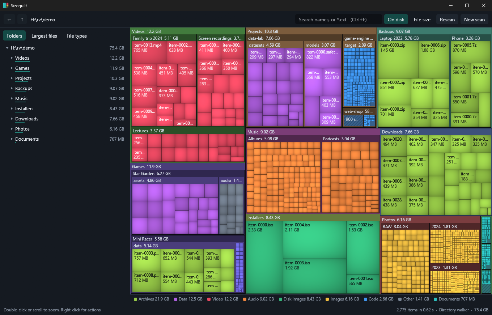

# Sizequilt

**See what's filling up your drive.**

Sizequilt draws your drive as a map. Every file is a tile, and the bigger the
tile, the more space it takes, so the things worth clearing out are easy to spot.
It's one small program for Windows, with nothing to install.



## Get started

1. Download `Sizequilt.exe` from the
   [latest release](https://github.com/Soupmeme/Sizequilt/releases/latest).
2. Double-click it.
3. Click a drive, or choose a folder.

You'll need 64-bit Windows 10 or later. Sizequilt has only been tested on
Windows 11.

### If Windows warns you

Sizequilt is a new program and isn't code-signed, which costs money this project
doesn't spend. Windows may warn you about it for that reason, and Microsoft
Defender has blocked some test builds as a suspected virus. We believe those were
false alarms, but Microsoft hasn't confirmed that.

**Please don't turn off your antivirus for it.** If you'd like to check it
yourself, the `Sizequilt-tester-kit.zip` on the release page includes a privacy
guide and check scripts. [PRIVACY.md](tester-kit/PRIVACY.md) walks you through
them, including how to scan with your internet off. You can also
[build it from source](#building).

## Finding your way around

| To do this | Do this |
|---|---|
| Open a folder | Double-click it, or anything inside it |
| Go in one level | Scroll up |
| Go back out | Scroll down, press `Backspace`, or click the up button |
| Go back to where you were | The back button, or your mouse's back button |
| Select something | Click its tile, and the folder list follows |
| See your options | Right-click, or use the buttons under the list |
| Search | Press `Ctrl+F`, then type a name, or `*.mp4` for a file type |
| Highlight a file type | Click it under **File types** |
| Move something to the Recycle Bin | Select it, press `Delete`, then confirm |

You can also browse a folder tree, see your largest files, and see how much space
each file type takes. Sizes can be shown as space used on disk or as file size.

## Is it safe?

**Your files.** Scanning only reads your drive and changes nothing on it. Sizequilt
never deletes anything by itself. Nothing moves unless you confirm that one named
item, and it goes to the Recycle Bin, so you can get it back. There's no bulk
delete and no automatic cleanup.

**Your system.** Windows folders, program folders, drivers and boot files, and
your main user folders are all protected, and the app won't move them. If
something could matter, such as a program or a large folder, you have to tick a
box to confirm you mean it. These protections only apply inside Sizequilt. They
don't stop File Explorer or other programs.

**Your privacy.** Sizequilt has no network code, collects no usage data and
doesn't update itself, so nothing is designed to leave your PC.
[PRIVACY.md](tester-kit/PRIVACY.md) explains how to check this for yourself.

**Your drives.** Sizequilt only scans at full speed on an internal SSD that passes
all of its checks. Every other drive, including hard drives, USB drives and network
drives, gets a gentler scan. If a drive starts answering slowly, the scan eases off
for the rest of the run and tells you.

No scan can make a failing drive safe, because it still has to read the drive. If
you think a drive is failing, back it up before you scan it.

## Why is my scan slow?

- **It's the first scan since you restarted.** Windows remembers what it has
  read, so the second scan is usually much faster.
- **It's a hard drive or a USB drive.** These get the gentler scan on purpose.
- **It says "Checking hard links…".** Some files, especially in Windows folders,
  appear in several places but are stored only once. Sizequilt checks them so that
  each is counted once and the map shows the right sizes.
- **It says the scan eased off.** The drive was answering slowly, so Sizequilt
  went easy on it. The results are just as complete.

### Permission prompts and scan methods

On a hard drive, Windows may ask you to approve Sizequilt. This lets it read the
drive's own index of files in one go, which is much faster than opening every
folder on a hard drive. It only reads. If you say no, the scan still runs, but it
takes longer.

**Automatic** is the right choice for almost everyone. You can pick a method
yourself on the start screen:

| Scan method | What it does | When to use it |
|---|---|---|
| **Automatic** | Picks a method for each drive | Almost always |
| **Folder walker** | Opens each folder in turn, with no permission prompt | A USB SSD, or when you don't want the prompt |
| **File table** | Reads the drive's own index in one go | A hard drive, or to count folders Windows won't normally open |

## The technical details

<details>
<summary>The full safety rules</summary>

### What a scan does to the disk

Scanning never changes anything on disk. The administrator step only reads the
drive; that process writes one file, in your temp folder, and exits.

Nothing is ever removed without your confirmation of that one named item. There
is no batch delete, no automatic cleanup and no way to empty the Recycle Bin.
Every move passes through one gatekeeper, `src/guard.rs`, and the code that
calls Windows' delete cannot compile without its approval.

### Blocked, with no override in the app

- Whole drives, and the folder you scanned
- `Windows`, `Windows.old`, `Program Files`, `Program Files (x86)`, `Boot`, `EFI`,
  `Recovery`, `WindowsApps`, `System Volume Information` and every `$` folder
  (`$Recycle.Bin`, `$WinREAgent`) at the top of any drive, with everything in them
- `Users`, any whole profile, the Public and Default profiles, `AppData` and its
  `Local` and `Roaming` folders, `AppData\*\Microsoft`, `.ssh` and `.gnupg`
- `ProgramData` itself and `ProgramData\Microsoft`
- Your Desktop, Documents, Downloads, Pictures, Music and Videos folders
  themselves, wherever they live; their contents are yours to manage
- Drivers and boot files anywhere: `.sys`, `.efi`, `.drv`, `.cpl`, `bootmgr`,
  `BCD`, and profile hives such as `NTUSER.DAT`
- Any folder containing one of those, or containing a protected folder
- Links and junctions, and anything reached through one
- Names Windows could read as something else: wildcards, trailing dots or
  spaces, device names such as `CON`, and paths too long for the shell

### Caution, where you must tick an acknowledgement first

Program files and folders holding them, AppData contents, ProgramData contents,
another user's files, the top of the Windows drive, key and password files, git
repositories, synced OneDrive folders, moves over 10 GB or 10,000 files, and
anything while running as administrator.

### Right before anything moves

The item is re-checked against the disk. The move is refused if it has gone,
changed since the scan, or now leads somewhere else. It's also refused if the
drive has no Recycle Bin, the bin is turned off, or the item is larger than the
bin, because Windows would delete it for good in those cases.

Only the selected item moves. Windows' habit of also taking a page's connected
`_files` folder is turned off, and programs and scripts are never started from
the app.

Every attempt is recorded in `%LOCALAPPDATA%\Sizequilt\actions.log`, and
nothing moves if that record can't be written.

To check the rules against a real drive, run
`target\release\sq-bench.exe --policy C:\`. It asks the guard about every item
and prints what would get through.

</details>

<details>
<summary>How scans protect your drives</summary>

The folder walker runs **2 workers**, meaning two folders are read at a time,
unless a disk proves it can take more. It gets one worker per CPU thread, up to
16, only if every one of these holds:

- The folder's real path, after links and `subst`, is on a drive letter's own
  volume, and that volume sits on one physical disk
- Windows calls the drive fixed, and it connects over SATA or NVMe, so not USB,
  RAID, Storage Spaces or a virtual disk
- The disk reports no seek penalty and supports TRIM

An unanswered question counts as a no. During the scan, if 8 of 32 folder
listings take 20 ms or longer, the scan drops to 2 workers until it ends and says
so, whatever the disk reported. A scan never uses more than 75% of the CPU.

These rules limit how hard a scan presses a disk, but they can't promise a
failing disk is safe. Any scan has to read it, and Windows doesn't show an app
without administrator rights how healthy a disk is.

After listing, the walker reads each group of hard links once so that their sizes
are current. A Windows drive can hold tens of thousands of these groups, and this
step runs on one thread.

</details>

<details>
<summary>How Automatic chooses, and speed measurements</summary>

**Automatic** asks each disk whether it pays a seek penalty, which needs no
administrator rights:

| Disk | Method used |
|---|---|
| SSD | Folder walker |
| Hard drive | File table, with an administrator prompt |
| Won't say | File table, with an administrator prompt |
| Not NTFS, or a network drive | Folder walker |

USB enclosures often don't pass the question through, so a USB drive usually
counts as "won't say". That suits a USB hard drive. A USB SSD is better on Folder
walker, which stays at 2 workers because USB can't prove what's behind it.

These were measured on real drives on the development machine. F: is a 932 GB
NTFS drive on USB, holding about 400,000 items:

| Scan of F: | Time | Items |
|---|---|---|
| Folder walker, cold (first scan after boot) | 162 s | 392,318 |
| File table | 5.5 s | 416,480 |
| Folder walker, warm (folder data in memory) | 2.0 s | 392,318 |

The file table costs about the same whenever it runs, while the walker depends
entirely on whether Windows has the folder data cached and how fast the drive
seeks. On D:, an NVMe drive with 880,000 items, the walker took 2 s when cached,
against roughly 40 s for the file table.

The file table also counted more on F: (446 GB against 443 GB), most likely
because it is not stopped by the folders Windows refuses to list.

Once a scan is loaded, a 2560×1440 map takes about 15 ms to lay out and paint,
and searching 575,000 names takes about 5 ms. Memory is about 75–90 bytes per
item, on top of about 100 MB for the app.

</details>

<details>
<summary>Starting a scan from the command line</summary>

```bash
Sizequilt.exe C:\
Sizequilt.exe D:\Games --walker
Sizequilt.exe H:\ --mft
```

With no flag, the method is chosen for the disk, as **Automatic** does.

</details>

## Building

Sizequilt is a native rebuild of the core of
[TreeMap](https://github.com/Prithvi-Web/TreeMap-Disk-Visualizer). TreeMap's scan
engine was already Rust, so this project reuses those crates and replaces what
surrounds them: Express, Electron and the browser UI.

Install [Rust](https://rustup.rs) with the `stable-x86_64-pc-windows-gnu`
toolchain, then:

```bash
.\build.ps1
.\build.ps1 test -p sizequilt --lib
```

The app is built to `target\release\sizequilt.exe`. Building takes a few minutes,
and it means you can read everything that goes into it. Each release lists the
SHA-256 hash of its `.exe`.

The MSVC toolchain is not needed. `src/bin/sq-bench.rs` times one scan with no
UI: `target\release\sq-bench.exe F:\`.

### Sharing with testers

`.\release.ps1` builds `dist\Sizequilt-tester-kit.zip` with the app,
[PRIVACY.md](tester-kit/PRIVACY.md) and the check scripts. It also writes
`dist\SHA256-send-separately.txt`. Send that hash through a different channel
from the zip.

A release stops if the tests fail, if code uses a socket type, if a networking
crate is in the build, if the built file contains network libraries, or if it
holds your username or project path. It also confirms that those checks can
fail, by giving them a known bad input first.

### Layout

| Path | What it holds |
|---|---|
| `src/tree.rs` | The scan as flat columns: sizes, sorting, removal |
| `src/scan.rs` | MFT first, walker as the fallback |
| `src/layout.rs`, `src/raster.rs` | Squarified layout, painted off the UI thread |
| `src/search.rs`, `src/category.rs` | Name search and file types |
| `src/guard.rs` | What may be moved: the only way to the Recycle Bin |
| `src/shell.rs` | Every Windows call: drives, elevation, Recycle Bin |
| `src/app/` | The interface (egui) |
| `vendor/` | Third-party crates, kept separate from the app |

## Licences

Sizequilt is released under the MIT License. See [LICENSE](LICENSE).

`vendor/tm-*` are copied unchanged from TreeMap, MIT, © 2026 Prithvi Vinay
(`vendor/LICENSE-TreeMap.txt`).

`vendor/windows-link` is windows-link 0.2.1 (MIT or Apache-2.0) with one change:
it links through ordinary import libraries instead of `raw-dylib`, because
`raw-dylib` on the GNU target needs an assembler that the Rust toolchain does
not ship.
